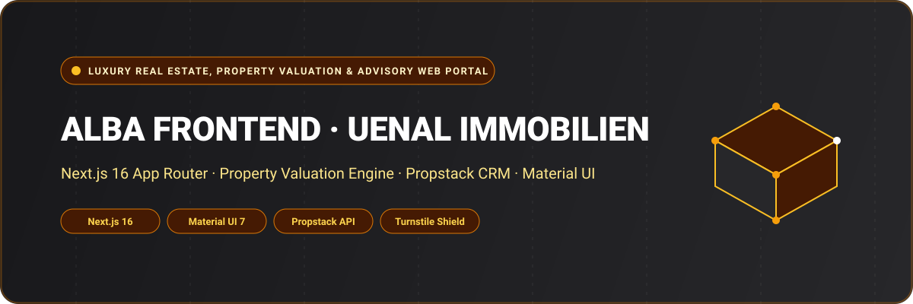

<div align="center">



# Alba Frontend — Uenal Immobilien GmbH Real Estate Portal

A premier real estate advisory, automated property valuation, and luxury listing portal engineered for German real estate firm **Uenal Immobilien GmbH**. Developed with **Next.js 16 (App Router)**, **React 19**, **Material UI 7**, **Radix UI**, **Cloudflare Turnstile**, and **Tailwind CSS**.

[](https://nextjs.org/)
[](https://react.dev/)
[](https://mui.com/)
[](https://www.radix-ui.com/)
[](https://developers.cloudflare.com/turnstile/)
[](https://www.typescriptlang.org/)
[](LICENSE)

</div>

---

## 🌟 Overview

**Alba Frontend (Uenal Immobilien GmbH)** delivers an elegant, high-converting digital experience connecting property buyers, high-net-worth investors, and sellers across the German real estate market. The platform combines interactive property search and filtering with a multi-step algorithmic property valuation tool (*Immobilienbewertung*) and streamlined seller onboarding workflows (*Haus verkaufen*, *Wohnung verkaufen*).

Integrated directly with real estate CRM systems like **Propstack** and protected by **Cloudflare Turnstile**, it ensures seamless lead qualification and inquiry delivery.

---

## 🚀 Key Features & Capabilities

- 🏡 **Dynamic Property Search & Filtering**: Fast search across houses, luxury apartments, and commercial real estate with price ranges, square footage, room count, and neighborhood parameters.
- 🧮 **Algorithmic Property Valuation Engine**: Multi-step interactive valuation wizard estimating property market worth based on construction year, area, and condition.
- 🤝 **Guided Seller Onboarding**: Dedicated lead funnels for homeowners looking to sell houses or condominiums with minimal friction.
- 🛡️ **Bot Protection & Secure Inquiries**: Cloudflare Turnstile integration defending against automated spam while maintaining an invisible user experience.
- 📬 **Automated Notification Dispatch**: Nodemailer SMTP integration routing consultation requests, buyer leads, and valuation reports instantly to licensed brokers.
- 🔍 **German Legal Compliance & SEO**: Fully localized German privacy standards (GDPR/DSGVO, Impressum, Widerrufsbelehrung, AGB) with dynamic metadata and OpenGraph SEO.

---

## 🏛️ System Architecture

```
[ Prospective Buyers & Property Sellers ]
                     │
                     ▼
       [ Cloudflare Turnstile Verification ]
                     │
                     ▼
       [ Next.js 16 App Router Frontend ]
   ├── Property Catalog (Search, Filtering & Detail Sheets)
   ├── Dynamic Property Valuation Engine (Immobilienbewertung)
   ├── Seller Onboarding Pipelines (Haus/Wohnung Verkaufen)
   └── Broker Contact & Viewing Appointment System
                     │
          ┌──────────┴──────────┐
          ▼                     ▼
   [ Propstack CRM API ]   [ SMTP / Nodemailer Broker Alerts ]
```

---

## 📁 Repository Structure

```
alba_frontend/
├── assets/
│   └── banner.svg                  # Architectural SVG project banner
├── public/                         # Architectural renders, logos, property photography
├── src/
│   ├── app/
│   │   ├── (default)/              # Main public real estate portal
│   │   │   ├── immobilien/         # Property listings and detailed viewports
│   │   │   ├── immobilienbewertung/# Online property valuation calculation wizard
│   │   │   ├── immobilienmakler/   # Broker services and team presentation
│   │   │   ├── haus-verkaufen/     # House seller onboarding funnel
│   │   │   ├── wohnung-verkaufen/  # Apartment seller onboarding funnel
│   │   │   ├── immobilie-verkaufen/# General commercial real estate selling
│   │   │   ├── leistungen/         # Full spectrum brokerage advisory services
│   │   │   ├── referenzen/         # Sold property portfolio & client testimonials
│   │   │   ├── blog/               # Market analysis, trends & real estate advice
│   │   │   ├── karriere/           # Employment opportunities
│   │   │   ├── ueber-uns/          # Corporate identity & founder story
│   │   │   ├── impressum/          # Legal notice & German regulatory disclosures
│   │   │   ├── datenschutz/        # GDPR / DSGVO privacy policy documentation
│   │   │   └── agb/                # Terms of service and brokerage stipulations
│   │   ├── api/                    # Serverless endpoints (Contact dispatch, valuation lead sync)
│   │   ├── layout.tsx              # Root HTML wrapper with theme & font providers
│   │   ├── globals.css             # Tailwind CSS tokens & styling
│   │   ├── robots.ts               # Automated search engine crawler instructions
│   │   └── seo.ts                  # Centralized OpenGraph metadata definitions
│   ├── components/                 # Property cards, valuation wizards, navigation bars
│   ├── constants/                  # Valuation parameters, regions, and property types
│   ├── lib/                        # Formatting utilities and email dispatchers
│   └── layout/                     # Header, footer, and navigation menus
├── package.json                    # Dependencies (Next.js 16, React 19, Material UI 7)
└── tsconfig.json                   # Strict TypeScript compiler options
```

---

## 💻 Tech Stack Specification

| Domain | Selected Technologies |
| :--- | :--- |
| **Framework** | Next.js 16 (App Router) |
| **Runtime & React** | React 19 & React DOM 19 |
| **Language** | TypeScript 5 (Strict Mode) |
| **UI Components** | Material UI (MUI) 7.3, Radix UI Primitives, Popper.js |
| **Bot Protection** | Cloudflare Turnstile (@marsidev/react-turnstile) |
| **Styling** | Tailwind CSS, Emotion Styled & React |
| **Email Dispatch** | Nodemailer (SMTP Gateway) |
| **CRM Integration** | Propstack REST API |

---

## 🛠️ Getting Started & Local Development

### Prerequisites

- **Node.js**: `v20.x` or higher
- **Package Manager**: `npm`, `yarn`, or `pnpm`

### 1. Clone the Repository

```bash
git clone https://github.com/shahjalal-labs/alba_frontend.git
cd alba_frontend
```

### 2. Install Dependencies

```bash
npm install
```

### 3. Configure Environment Variables

Create a `.env.local` file:

```env
NEXT_PUBLIC_BASE_URL_LOCAL=http://localhost:3000
NEXT_PUBLIC_TURNSTILE_SITE_KEY=your_turnstile_site_key
NEXT_PUBLIC_PROPSTACK_API_KEY=your_propstack_api_key

# SMTP Credentials
SMTP_HOST=smtp.mailgun.org
SMTP_PORT=587
SMTP_USER=postmaster@example.com
SMTP_PASS=your_smtp_password
CONTACT_RECIPIENT_EMAIL=info@uenal-immobilien.de
```

### 4. Run Development Server

```bash
npm run dev
```

Open [http://localhost:3000](http://localhost:3000) to view the application.

---

## 👨‍💻 Engineering & Authorship

Developed and engineered by **Md. Shahjalal**.

- **GitHub**: [@shahjalal-labs](https://github.com/shahjalal-labs)
- **Email**: [muhommodshahjalal@gmail.com](mailto:muhommodshahjalal@gmail.com)

---

## 📄 License

This project is open-source and available under the [ISC License](LICENSE).
